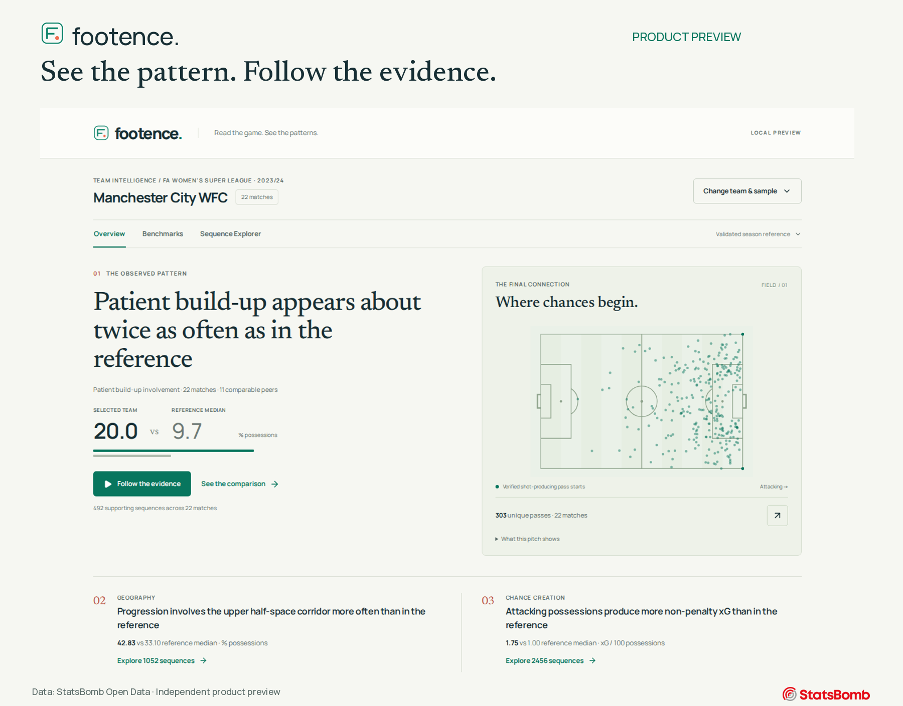
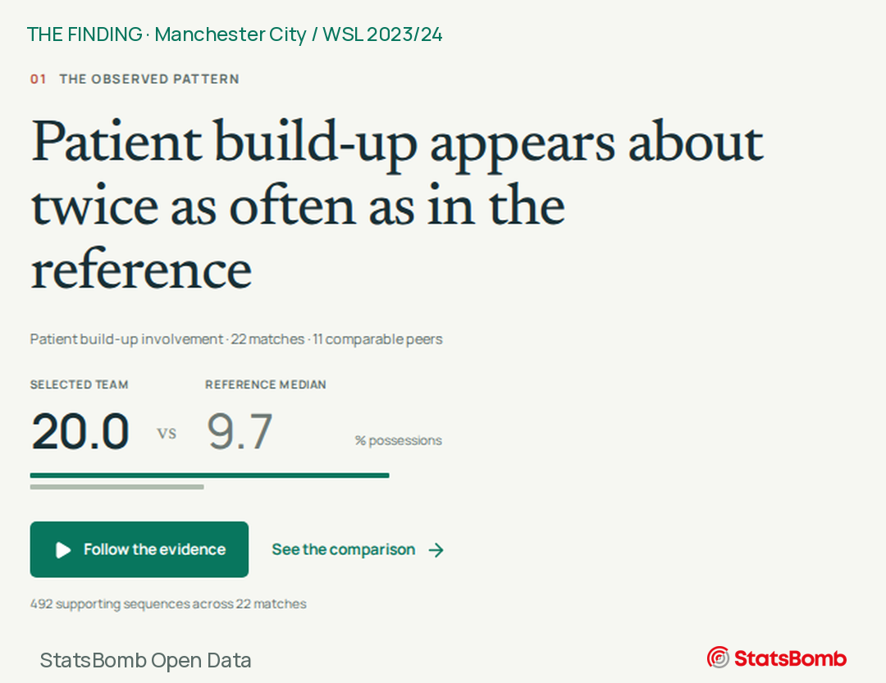
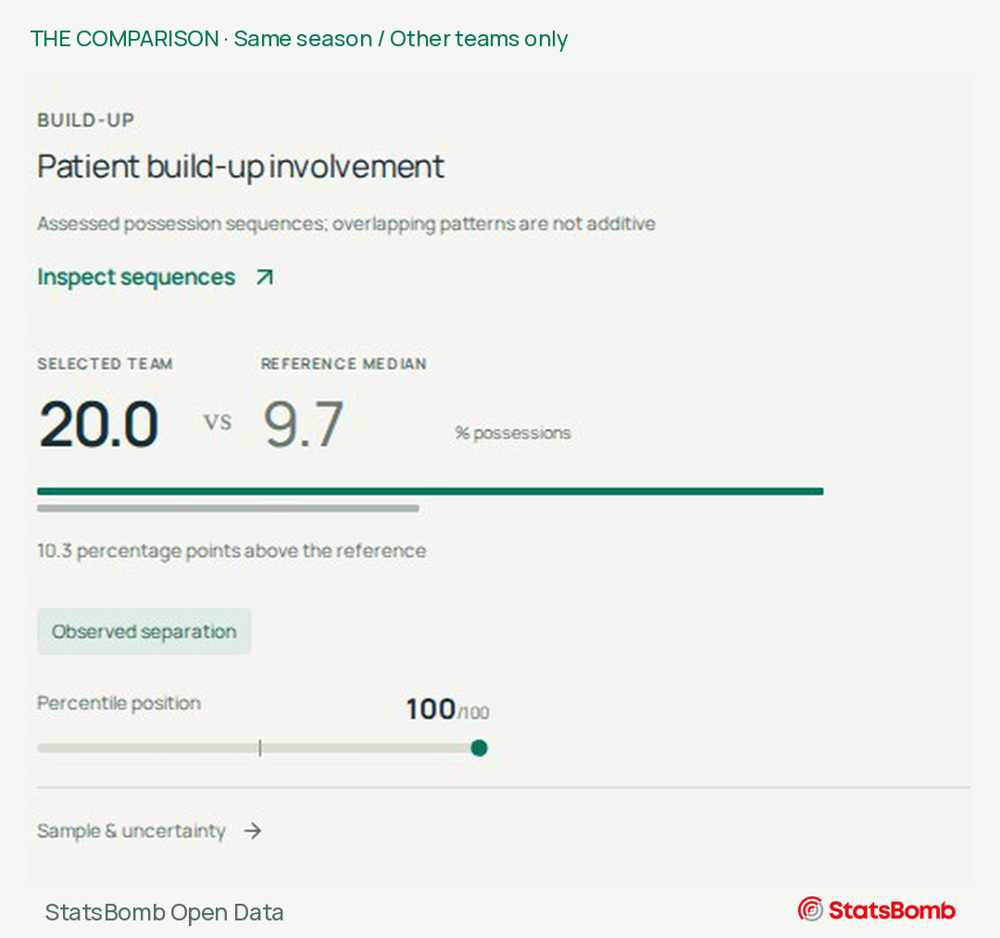
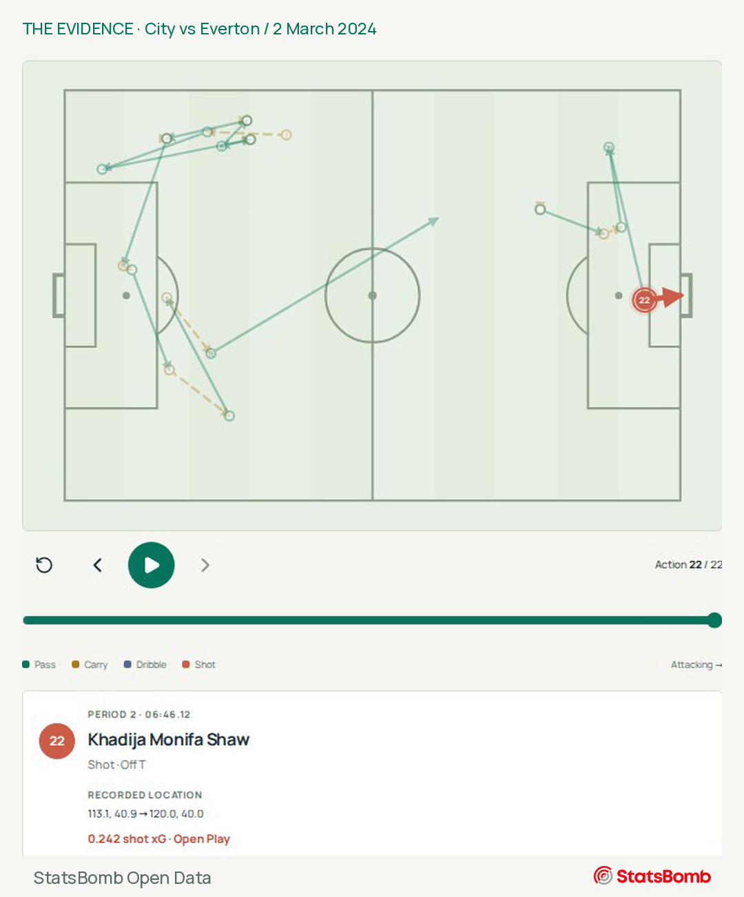
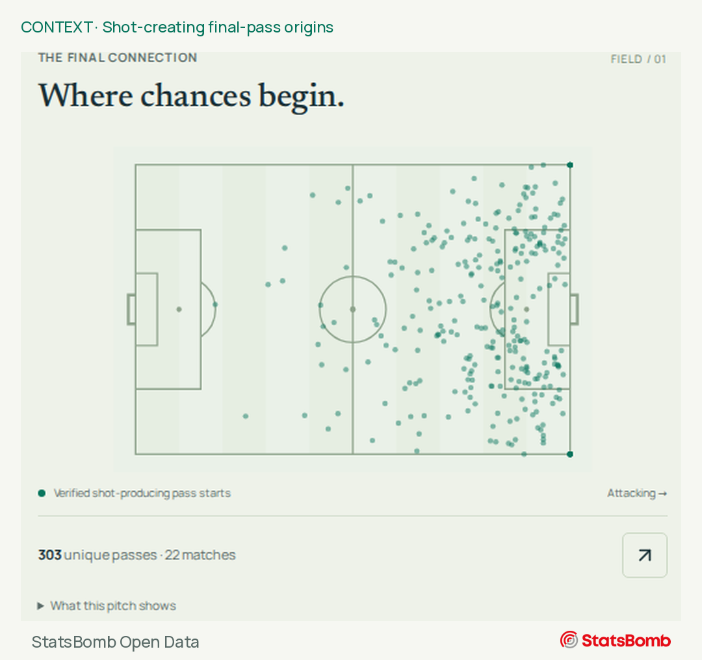

# Footence

**Read the game. See the patterns.**

Understand how teams build attacks, create chances and differ from their competitors—with real evidence behind every finding.

[**Watch the 32-second demo**](assets/video/footence-linkedin-32s.mp4) · [Full-size screenshot gallery](assets/screenshots/gallery.png) · [Four-slide carousel](assets/carousel/README.md)

**Independent football intelligence project by Fady Iben Habel.** This repository is a product showcase. The application and analytical implementation remain private.

## Find the pattern

Manchester City's **22-match WSL 2023/24** report shows patient build-up in **20.0% of assessed possessions**, compared with a **9.7% median among the other 11 teams**.

That is about twice the peer median—not most of City's possessions, and not a permanent tactical identity.

## Compare it with the right teams

**492 of 2,456 assessed possessions. 11 peers. A 10.3 percentage-point difference.** The comparison uses the same competition and season and excludes City from its own reference.

Comparisons are exploratory. A percentile is a position in this reference population, not a probability, a prediction or a measure of how well a team plays. Sample size, missing attribution and uncertainty can limit the comparisons available.

## Follow the evidence onto the pitch

**Manchester City vs Everton · 2 March 2024 · 22 recorded actions · 1 shot · 0.242 xG.**

Sequence Explorer follows the actual on-ball events, from the selected possession to Khadija Shaw's final shot. Step through the actions or reveal the complete sequence. The player, timestamp and outcome stay attached to the selected evidence.

This is an illustrative example behind the finding, not proof of the full-season pattern. It shows recorded events, not match footage, tracking data or inferred off-ball runs.

[**Watch the demonstration →**](assets/video/footence-linkedin-32s.mp4)

32 seconds · 4:5 portrait · Silent, with on-screen captions · Real application recordings. The extended replay excerpt is labelled at 2× recording speed; action playback is not match time. [Text description](assets/video/TRANSCRIPT.md). Download the MP4 if your repository viewer does not play it inline.

## A different view of chance creation

The map below is **separate descriptive context**: the origins of **303 unique shot-producing final passes** across City's 22 matches. It does not represent the patient-build-up population above.

Chance production and chance quality answer different questions. City's selected report contains **45.06 non-penalty xG from 427 non-penalty shots**, or **0.106 mean xG per shot**. These values describe observed opportunities; they do not establish finishing skill or predict a future result.

## One connected workflow

- **Team Overview:** selected football findings, spatial evidence and chance-quality summaries.
- **Competition Benchmarks:** eligible team-versus-peer comparisons, with sample and uncertainty context.
- **Sequence Explorer:** supporting examples, contextual possessions, filters and recorded-action playback.

WSL 2023/24 and Frauen-Bundesliga 2023/24 have independent references, each covering **132 fixtures and 12 teams**. Their percentiles are never pooled. The featured report uses only the WSL reference.

Footence combines Python analytics, a FastAPI service and a React / TypeScript interface. There is no public app deployment or installation in this showcase. Dedicated Build-Up, detailed Chance Creation and Match Analysis destinations are not yet part of the React preview.

## Creator

Footence is an independently developed football intelligence project created by **Fady Iben Habel**.

For project discussion or collaboration: [Fady Iben Habel on GitHub](https://github.com/FadyIbenHabel).

**LinkedIn: (https://www.linkedin.com/in/fady-iben-habel/)**

## Data and credits

Data provided by **[StatsBomb Open Data](https://github.com/hudl/open-data)** under its [Public Data User Agreement](https://github.com/hudl/open-data/blob/master/LICENSE.pdf). This is a non-commercial research and portfolio preview; raw datasets are not redistributed. No endorsement by StatsBomb, clubs or competitions is implied.

Footence presentation by Fady Iben Habel. See [credits and asset rights](CREDITS.md). No broadcast footage, music or stock imagery is included.
