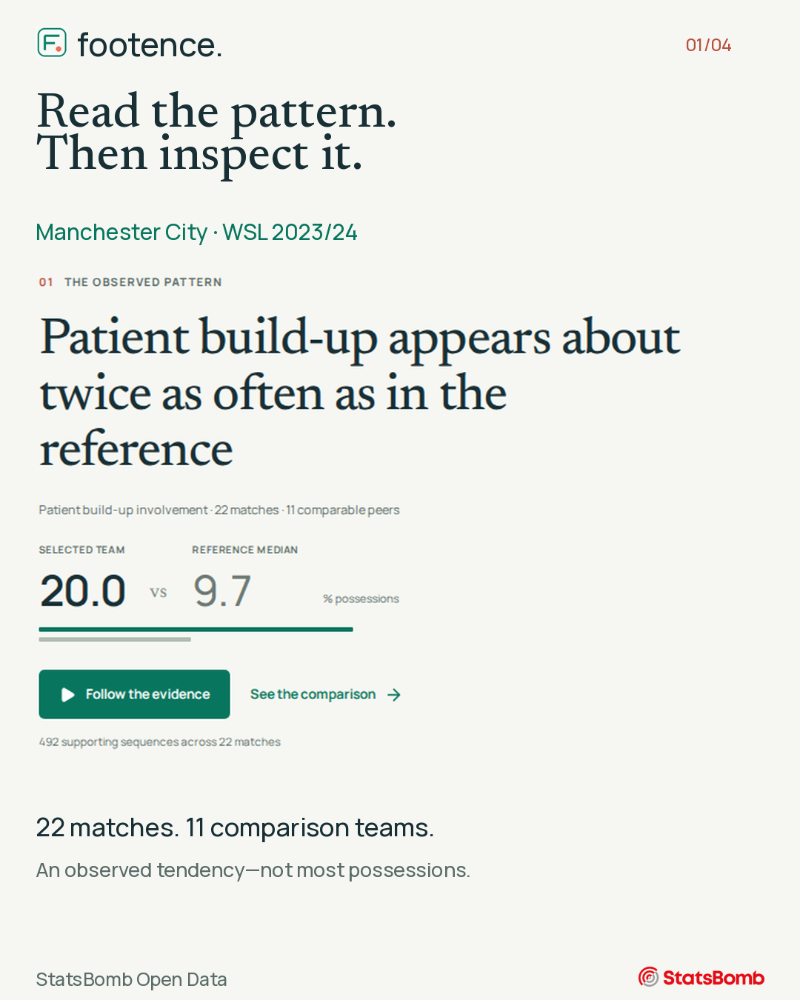
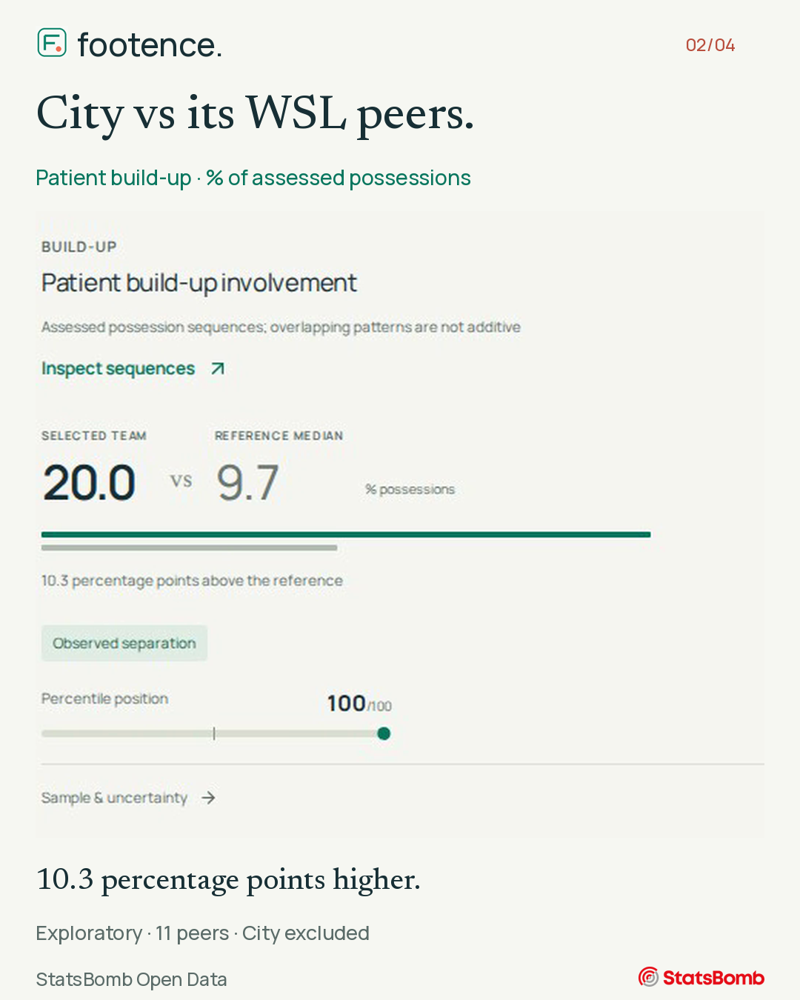
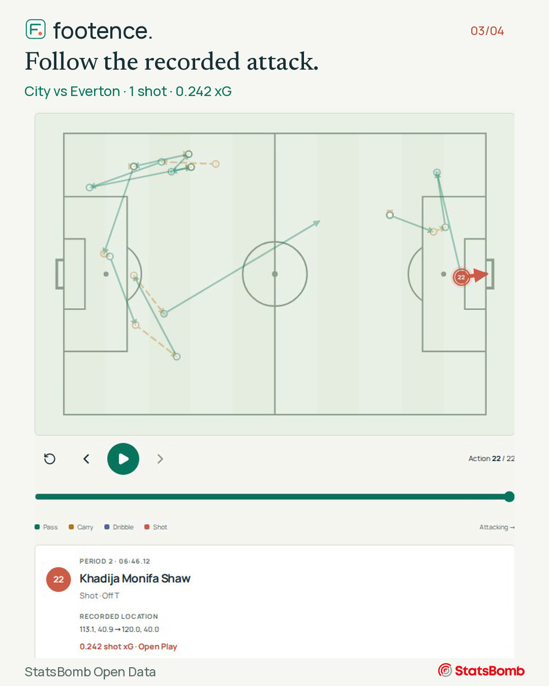
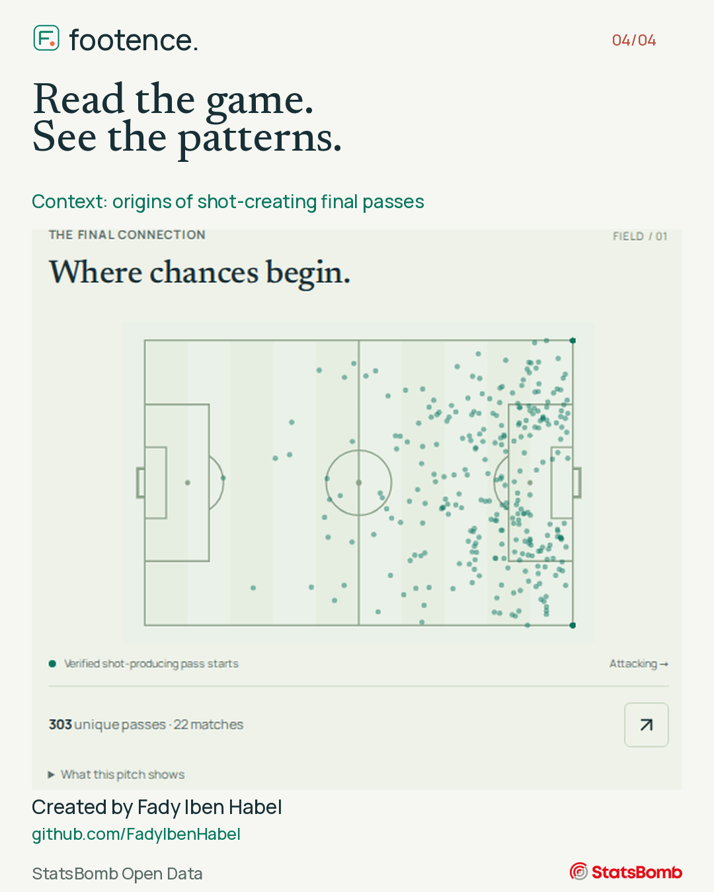

# Footence in four frames

A closer look at the report, its competition context and the recorded evidence behind it. Each image is 1080 × 1350 pixels.

## 1. Find the pattern

## 2. Compare with the right peers

## 3. Inspect a real sequence

## 4. Read the game. See the patterns.

Data: [StatsBomb Open Data](https://github.com/hudl/open-data). [Credits](../../CREDITS.md) · [Back to Footence](../../README.md)
